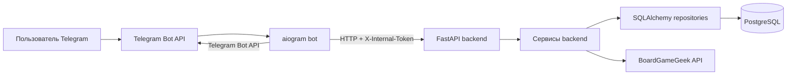
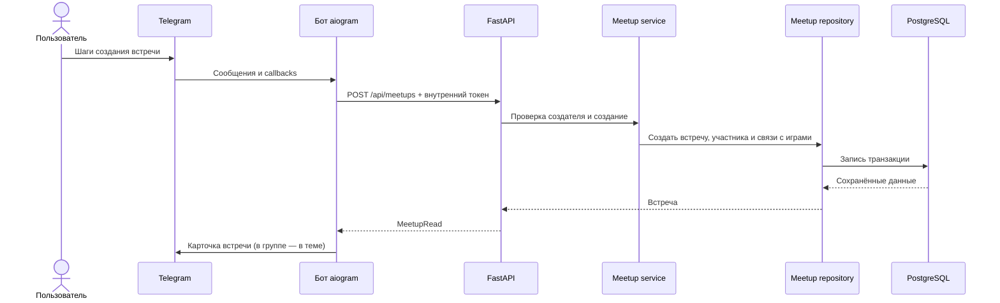

# Архитектура проекта

## Назначение

`boardgames_meetup_bot` объединяет Telegram-бота и внутренний HTTP API для организации встреч по настольным играм. Пользователь может синхронизировать Telegram-профиль, импортировать коллекцию из BoardGameGeek (BGG), просматривать свою и чужие коллекции, подбирать игру по числу игроков, создавать встречи, записываться на них и предлагать игры для встречи. В группах с включёнными темами бот может публиковать карточки встреч в заданной теме.

## Технологический стек

| Область | Технологии |
| --- | --- |
| Язык и окружение | Python `>=3.12,<3.15` |
| Telegram | aiogram 3; long polling и Telegram Bot API |
| HTTP API | FastAPI, Uvicorn, Pydantic |
| HTTP-клиент бота | HTTPX, асинхронные запросы к backend |
| Хранение | PostgreSQL 16, SQLAlchemy 2.x, psycopg 3 |
| Миграции | Alembic |
| BGG | `bgg-api` |
| Тесты и инструменты | pytest, pytest-asyncio, pytest-cov, Ruff |
| Контейнеры | Docker и Docker Compose |

## Структура проекта

- `backend/app/main.py` — создаёт FastAPI-приложение, подключает API-маршруты и endpoint `/health`.
- `backend/app/api/` — HTTP-маршруты, сгруппированные по пользователям, играм, встречам и импорту.
- `backend/app/services/` — прикладные операции и правила предметной области.
- `backend/app/db/models/` — SQLAlchemy-модели и перечисления.
- `backend/app/db/repositories/` — запросы и изменения данных через SQLAlchemy.
- `backend/app/schemas/` — Pydantic-схемы запросов и ответов API.
- `backend/app/dependencies/` — зависимости FastAPI для сессии БД и проверки внутреннего токена.
- `backend/app/core/` — настройки, базовая конфигурация логирования и проверка внутреннего токена.
- `backend/app/clients/bgg.py` — создание клиента BGG и чтение принадлежащих пользователю элементов коллекции.
- `backend/migrations/versions/` — последовательные миграции схемы Alembic; текущая последняя ревизия — `0006_allow_shared_bgg_username`.
- `bot/app/main.py` — точка запуска бота; собирает aiogram `Dispatcher` и запускает polling.
- `bot/app/handlers/` — обработчики команд, сообщений и callback-запросов.
- `bot/app/services/backend_api.py` — HTTP-клиент для backend; `game_service.py` загружает и группирует игры для интерфейса.
- `bot/app/keyboards/`, `states/`, `middlewares/`, `filters/`, `texts/`, `utils/` — клавиатуры, состояния диалогов, вспомогательные компоненты и форматирование.
- `tests/unit/`, `tests/integration/`, `tests/fixtures/` — модульные и интеграционные тесты и фикстуры.
- `docker/docker-compose.yml`, `docker/Dockerfile`, `docker/wait-for-postgres.sh` — контейнерный запуск PostgreSQL, миграций, backend и бота.
- `pyproject.toml` — диапазон Python, зависимости, конфигурация pytest и Ruff.
- `alembic.ini` и `backend/migrations/env.py` — настройка Alembic; URL БД берётся из настроек приложения.

## Архитектура и компоненты



### Telegram-бот

`bot/app/main.py` запускает `Dispatcher.start_polling`. Маршрутизатор из `bot/app/router.py` подключает обработчики старта, профиля, игр, импорта, встреч и случайной игры. Пользовательские действия обрабатываются в handlers; данные и бизнес-операции запрашиваются у backend через `BackendAPIClient`, а не через прямые запросы к базе.

В обработчиках встреч используется FSM aiogram для многошагового создания и выбора параметров. В групповом сценарии бот находит или создаёт форум-тему, создаёт встречу в backend, отправляет сообщение или изображение в Telegram-тему и сохраняет ID опубликованного сообщения в backend. Выбор игр для предложения проходит в личном чате; если пользователь ещё не запускал бота, кнопка открывает deep link для `/start`. Сохранённые предложения загружаются вместе со встречей и отображаются при обновлении групповой карточки.

### Backend API

`backend/app/main.py` создаёт приложение FastAPI. Маршрутизаторы из `backend/app/api/router.py` подключены под `/api`; зависимость проверки `X-Internal-Token` применяется ко всем этим маршрутам. `/health` объявлен отдельно и этой зависимостью не защищён.

Маршруты проверяют входные данные через схемы Pydantic и передают работу сервисам. Сервисы используют репозитории и SQLAlchemy-модели. API-обработчики преобразуют известные ошибки предметной области в HTTP-ответы. API-функции и используемый `Session` SQLAlchemy синхронные.

### Доступ к данным и схема

`backend/app/db/session.py` создаёт синхронный SQLAlchemy engine с `pool_pre_ping=True` и фабрику сессий. Зависимость `get_db` открывает сессию на время запроса и закрывает её после.

Модели наследуются от общей декларативной базы из `backend/app/db/base.py`; для временных полей используется `TimestampMixin`. Состав моделей импортируется в `backend/app/db/models/__init__.py`, а Alembic получает метаданные через `backend/migrations/env.py`.

## Взаимодействие компонентов и основные сценарии

### Регистрация и синхронизация профиля

При `/start` бот отправляет Telegram ID, имя и username в `POST /api/users/telegram`. Backend вычисляет отображаемое имя и выполняет upsert пользователя по Telegram ID. Для последующих операций бот получает внутренний ID пользователя через `GET /api/users/by-telegram/{telegram_id}`.

### Импорт коллекции BGG

1. Бот получает BGG username из профиля или запрашивает его, затем вызывает `POST /api/imports/bgg/collection`.
2. Backend находит пользователя, сохраняет username при необходимости, создаёт запись `bgg_import_jobs` и переводит её в `in_progress`.
3. Через `bgg-api` загружаются принадлежащие пользователю базовые игры и дополнения; для каждого элемента загружаются подробности.
4. Игры создаются или обновляются, владение отражается в `user_games`, а устаревшие связи, созданные импортом BGG для этого пользователя, удаляются.
5. Backend возвращает сводку импорта после выполнения операции; бот показывает результат.

Импорт выполняется синхронно внутри API-запроса. Отдельной очереди или фонового worker-процесса в проекте не обнаружено. Запись job хранит статус, но отдельного API для запроса статуса job нет.

### Игры и подбор

Бот запрашивает у backend игры пользователя или список других пользователей с коллекциями. Backend применяет фильтры через сервис игр и репозиторий. Для представления коллекции бот связывает дополнения с базовыми играми по сохранённым BGG ID расширяемых игр. Команда `/random_game` отбирает варианты по диапазону числа игроков и исключает игры с кампанией.

### Создание встречи и участие

При создании бот собирает дату, выбранные игры, вместимость и комментарий; затем отправляет `POST /api/meetups`. Backend проверяет существование создателя, сохраняет встречу, автоматически добавляет создателя как участника и связывает выбранные игры. При записи проверяются статус встречи, существование пользователя, повторное участие и свободная вместимость. При выходе статус участия меняется на `cancelled`.

Для Telegram-групп бот передаёт chat/thread ID встречи, публикует карточку через Telegram Bot API и затем сохраняет ID сообщения через `POST /api/meetups/{id}/telegram-message`. Удалить встречу может только её создатель; проверка выполняется в сервисе встреч.

Предложение игры запускается из групповой карточки, а коллекция и игры выбираются в личном чате бота. Backend проверяет, что выбранная коллекция принадлежит предлагающему, автору встречи или записавшемуся участнику, а игры действительно связаны с этой коллекцией. Новое предложение заменяет прежнее предложение этого пользователя; отдельные записи `meetup_game_suggestions` сохраняют выбранные игры и автора, не смешивая их с играми, изначально назначенными встрече.



## Внешние интеграции

- **Telegram Bot API** — входящие обновления через long polling и отправка сообщений, клавиатур, изображений и операций с форум-темами. Реализовано библиотекой aiogram.
- **Внутренний backend API** — бот вызывает FastAPI по HTTP через HTTPX; защищённые `/api` запросы передают заголовок `X-Internal-Token`. Значения URL и токена задаются конфигурацией.
- **BoardGameGeek API** — чтение коллекции и сведений об играх через `bgg-api`; доступ настраивается переменной `BGG_ACCESS_TOKEN`.
- **PostgreSQL** — основное постоянное хранилище данных; backend подключается через SQLAlchemy и psycopg.

## Данные и хранение

| Сущность | Назначение и связи |
| --- | --- |
| `User` (`users`) | Telegram-профиль и BGG username. Telegram ID уникален; пользователь связан с играми, встречами, импортами и членством в чатах. |
| `Game` (`games`) | Каталог игр по уникальному BGG ID: название, число игроков, длительность, тип, кампания и кэшированные BGG-механики/ID расширяемых игр. |
| `UserGame` (`user_games`) | Связь пользователя и игры, включая источник владения, доступность для встреч и комментарий. Пара user/game уникальна. |
| `Meetup` (`meetups`) | Запланированная встреча, создатель, дата, вместимость, комментарий и Telegram chat/thread/message IDs. |
| `MeetupParticipant` (`meetup_participants`) | Связь пользователя и встречи со статусом участия; пара meetup/user уникальна. |
| `MeetupGame` (`meetup_games`) | Игры встречи и пользователь, добавивший игру; пара meetup/game уникальна. |
| `MeetupGameSuggestion` (`meetup_game_suggestions`) | Предложенные для встречи игры, автор предложения и источник коллекции; повторное предложение заменяет игры этого пользователя для данной встречи. |
| `BggImportJob` (`bgg_import_jobs`) | Статус, username, количество импортированных элементов, даты выполнения и сообщение ошибки. |
| `TelegramChatTopic` (`telegram_chat_topics`) | Идентификатор чата, ID форум-темы и необязательный заголовок; на чат приходится одна запись. |
| `TelegramChatMember` (`telegram_chat_members`) | Связь пользователя с зарегистрированным Telegram-чатом. |

Связи и ограничения объявлены в моделях и миграциях. Первичная схема находится в `backend/migrations/versions/0001_initial_schema.py`; последующие ревизии добавляют кэш расширений BGG, Telegram-поля встреч, форум-темы, участников чатов и предложения игр. Ревизия `0006_allow_shared_bgg_username` удаляет уникальность BGG username, поэтому разные пользователи могут указывать один ник.

## Конфигурация и запуск

`backend/app/core/config.py` использует Pydantic Settings: значения берутся из окружения и `.env` в рабочем каталоге. `.env.example` содержит шаблон; реальные значения секретов в документацию не включаются.

Основные переменные:

| Переменная | Назначение |
| --- | --- |
| `APP_ENV` | Окружение приложения; по умолчанию `dev`. |
| `DB_HOST`, `DB_PORT`, `DB_NAME`, `DB_USER`, `DB_PASSWORD` | Подключение к PostgreSQL; `DB_PASSWORD` обязателен. |
| `TELEGRAM_BOT_TOKEN` | Токен Telegram-бота. |
| `BGG_ACCESS_TOKEN` | Доступ клиента BGG. |
| `INTERNAL_API_TOKEN` | Общий токен доступа к `/api`. |
| `BACKEND_HOST`, `BACKEND_PORT`, `BACKEND_BASE_URL` | Адрес прослушивания и базовый URL backend. |
| `TELEGRAM_GROUP_ID` | Необязательный целевой Telegram-чат для группового сценария. |
| `TELEGRAM_TOPIC_NAME` | Название темы встреч в форуме Telegram. |

Локальный запуск после установки зависимостей, описанной в `README.md`:

```powershell
uvicorn backend.app.main:app --reload
python -m bot.app.main
```

Для полного контейнерного запуска Compose определяет `postgres`, одноразовый `migrate`, `backend` и `bot`. Backend ждёт готовности PostgreSQL и успешного контейнера миграций; бот зависит от healthcheck backend. Для контейнерной сети Compose переопределяет `DB_HOST=postgres` и `BACKEND_BASE_URL=http://backend:8000`. PostgreSQL использует именованный volume `postgres_data`.

Документированные в README команды полного запуска и просмотра состояния:

```powershell
docker compose --env-file .env -f docker/docker-compose.yml up -d --build
docker compose --env-file .env -f docker/docker-compose.yml ps
```

Команда `up` изменяет состояние контейнеров и хранилища; здесь она приведена как инструкция, но при подготовке документа не запускалась.

## Ошибки, логирование и асинхронность

Backend и бот настраивают стандартный Python logging на уровень `INFO`. API-маршруты преобразуют отдельные известные ошибки сервисов в HTTP-коды, например `404`, `409` и `403`. Бот обрабатывает HTTP-ошибки backend и сообщает пользователю о недоступности API или ошибке операции.

Клиент BGG повторяет некоторые запросы при временных ошибках; детали игр при исчерпании повторов пропускаются с предупреждением. Для ожидаемых ошибок импорта сервис откатывает изменения и помечает job как `failed`. При этом вызовы BGG и ожидания повторов синхронны внутри запроса, поэтому импорт не является фоновой задачей.

Асинхронный polling и сетевые операции бота реализованы на aiogram/HTTPX. FastAPI endpoints и SQLAlchemy доступны как синхронные функции; отдельный scheduler, очередь задач или worker в проекте не обнаружены.

## Тестирование

Тесты находятся в `tests/unit/` (bot, clients, services) и `tests/integration/` (API и БД). Общие фикстуры — в `tests/conftest.py`, данные — в `tests/fixtures/`. Pytest настроен в `pyproject.toml`: корень тестов `tests`, `pythonpath = ["."]`, asyncio mode `auto`.

Для запуска используется установленный dev-набор зависимостей и команда:

```powershell
pytest
```

Интеграционные фикстуры используют настроенный SQLAlchemy engine и подключаются к БД; перед запуском должны быть заданы настройки окружения и доступна тестовая PostgreSQL. API-тестовый клиент устанавливает внутренний заголовок и подменяет зависимость сессии. Фикстура сессии откатывает транзакцию после теста. В репозитории не обнаружены workflow CI в `.github`.

## Ограничения и технические особенности

- `/health` не входит в `/api` и не требует `X-Internal-Token`; все подключённые API-маршруты под `/api` требуют этот заголовок.
- BGG-импорт синхронный и удерживает API-запрос до завершения; отдельный endpoint для получения состояния import job отсутствует.
- В `backend/app/api/routes/admin.py` зарегистрирован пустой роутер без endpoint; `bot/app/handlers/profile.py` и `bot/app/middlewares/user_context.py` содержат заглушки.
- В README раздел «Что будет следующим шагом» описывает модели, миграции и API как будущую работу, однако они уже присутствуют в исходниках. При выяснении актуального поведения следует ориентироваться на код и миграции.
- Проектный Compose использует именованный volume `postgres_data`; локальный каталог `docker/postgres/data` этим Compose-файлом не подключён.